# mitv-axso2

Reversible user-interface customisation for the **Xiaomi Mi TV MiTV-AXSO2**
(Android TV 11), done entirely over ADB from a PC — no root, no flashing.
Launcher, system settings, animations, display density, hidden or disabled
preinstalled apps: every change ships with an `apply`, a `revert` and a
`check` script so it can always be undone.

## What it looks like

**AXS Home** replaces the stock home screen: your apps in one row, your
consoles and TV inputs one press away along the bottom, a clock, network
status and an animated wallpaper. No ads, no recommendations, no internet
access, and it opens in about half a second.

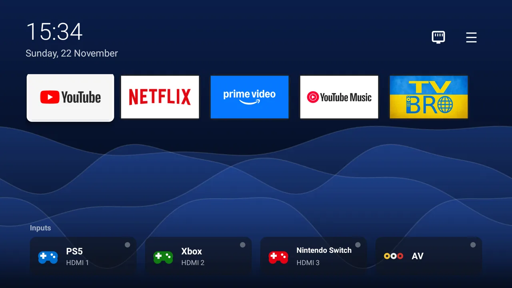

- **Apps**: YouTube, Netflix, Prime Video, YouTube Music, Browser (TV Bro),
  spread evenly in one row that scrolls sideways when you add more. The
  selected app zooms in with a ring around it, console-style. Long-press OK
  to rearrange them on the TV.
- **Inputs**: Aerial TV (antenna, opens Live TV), HDMI 1–3 and AV. OK
  switches input; the dot turns green while an HDMI/AV input is sending a
  picture. Cards use the names you gave the inputs in the TV's own Settings →
  Inputs; ☰ → Home settings → **Inputs** renames a card, changes its icon and
  colour, or hides it (defaults in `home.conf`).
- **Top right**: network status (Ethernet or Wi-Fi) and the ☰ menu (Settings,
  Play Store, Home settings, System monitor, Phone remote, All apps, Reset
  app order).
- **Screensaver**: AXS Clock, a large clock and date over dimmed animated
  waves, with the weather for your city and up to eight market tiles
  (USD/IDR, EUR/USD, gold, BTC… by default, free sources credited on
  screen). ☰ → Home settings → Screensaver picks the tickers and where each
  comes from: opt-in Yahoo Finance adds live FX, IHSG, S&P 500, Dow, NASDAQ
  and oil; Twelve Data and Finnhub work with your own free key.
- Ads, tracking and unused Xiaomi/Google apps are disabled, and system
  animations run twice as fast.

Built-in wallpapers (original designs) — or use your own image, GIF or video:

| Orbit | Pop | Bloom |
|---|---|---|
| 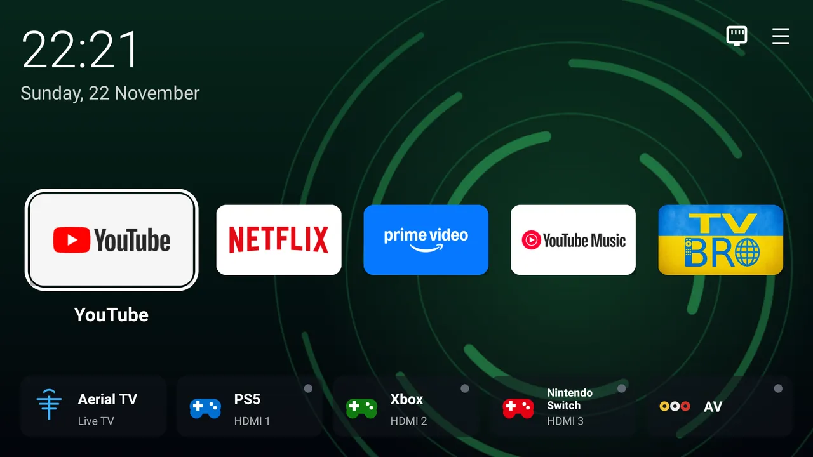 | 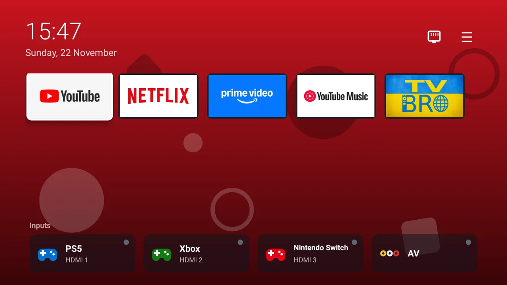 | 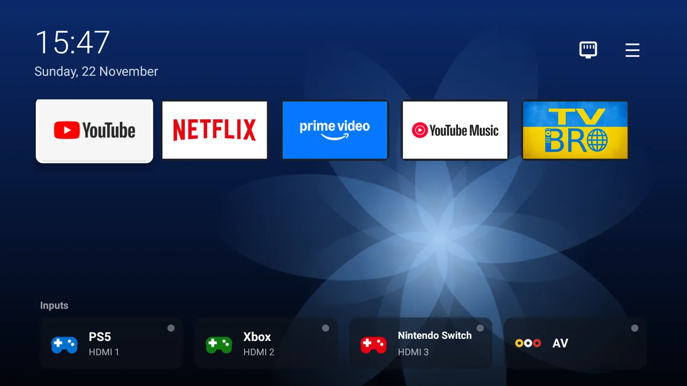 |

Home settings (☰ → Home settings): the wallpaper keeps moving behind a
translucent panel; Clock, Wallpaper (with live previews and your own file),
Sound, Inputs (names, icons, colours of the input cards) and Screensaver (tickers, data sources, refresh), in the same focus
style as the app tiles:

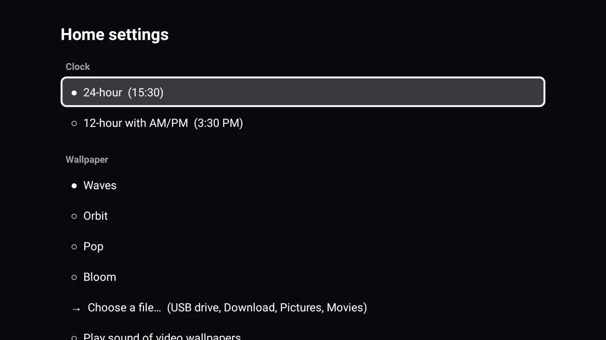

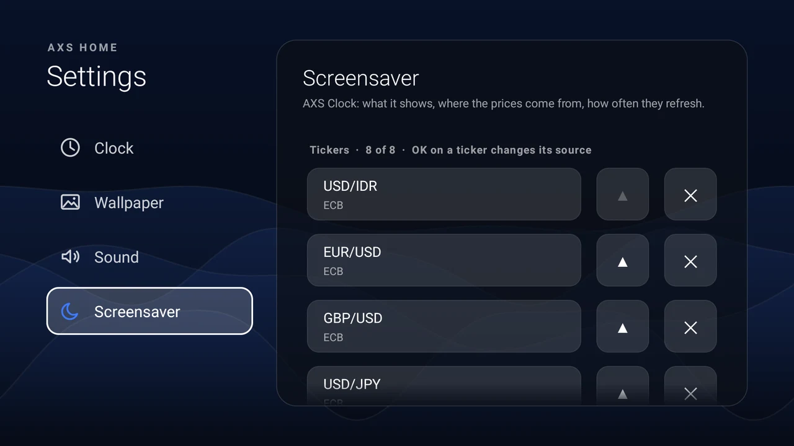

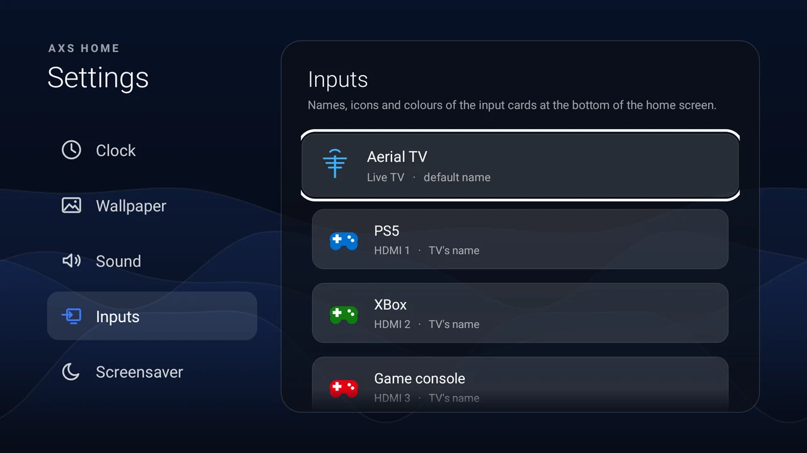

System monitor (☰ → System monitor): CPU clock, memory, storage and uptime,
live, plus the apps used today. Android 11 does not let apps read other
apps' CPU or memory, so for an htop-like list run `sh scripts/tv.sh top` on
the PC:

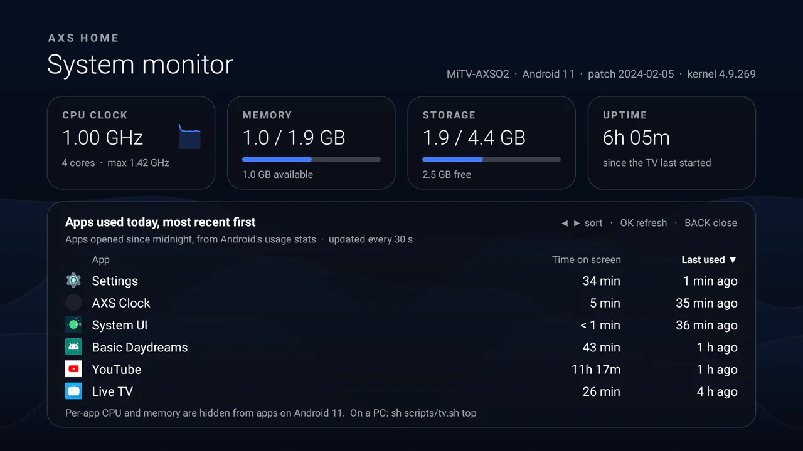

Phone remote: open `http://<TV IP>:8077` on an iPhone or Android phone
(☰ → Phone remote shows the address and a QR code for it) and the browser
becomes a remote — D-pad, volume, media keys, an aerial-TV number pad, and
typing with the phone's keyboard whenever a text box is focused on the TV.
Served by the TV itself on the home network, no pairing; nothing to
install:

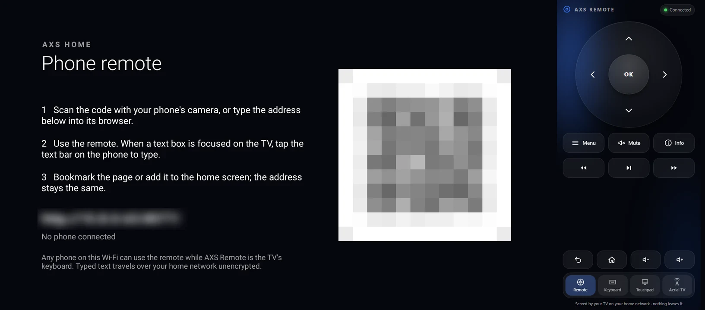

The page has four modes — Remote, Keyboard, Touchpad (a pointer on the TV:
drag, tap, two-finger scroll) and Aerial TV — with line icons and colours
that follow the TV's wallpaper:

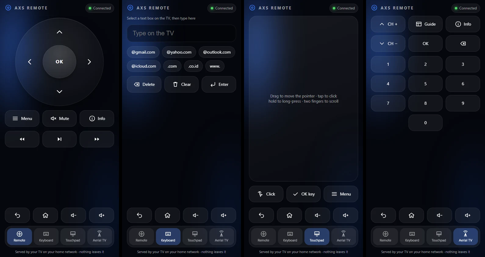

The TV's own on-screen keyboard (AXS Remote, for the physical remote) has a
Hide key, one-press `@gmail.com` / `.com` suggestions in e-mail and web
address fields, symbols, and a 📱 key that shows the phone-remote QR code
to type on the phone instead:

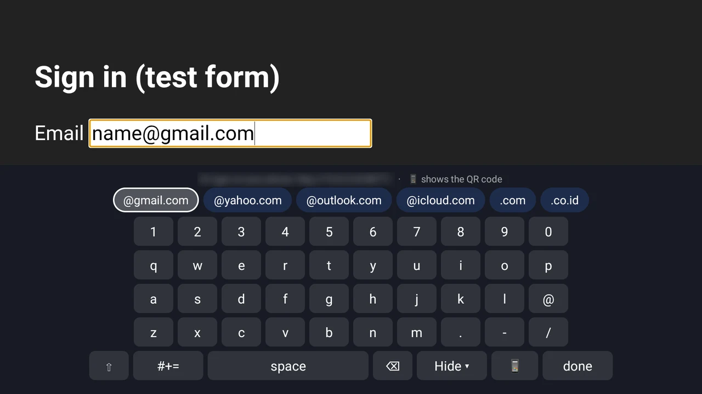

## Target device

| | |
|---|---|
| Model | MiTV-AXSO2 (letter O) |
| Android | 11 (API 30), Android TV |
| Security patch | 2024-02-05 |
| Kernel | 4.9.269 |
| Default launcher | Google TV launcher (`com.google.android.tvlauncher`) |

Other firmware versions may work, but package names and menus can differ.
Check yours with `sh scripts/tv.sh info` (see below).

---

## 1. Requirements (PC)

- **Android SDK Platform-Tools** (provides `adb`):
  https://developer.android.com/tools/releases/platform-tools
  - Windows: unzip it, e.g. to `C:\platform-tools`, and add that folder to
    `PATH` — or install Android Studio, which puts it in
    `%LOCALAPPDATA%\Android\Sdk\platform-tools`.
  - macOS: `brew install android-platform-tools`
  - Linux: `sudo apt install adb` (or your distro's equivalent)
- **Git** (on Windows, Git for Windows includes Git Bash, used to run the
  scripts).
- The PC and the TV on the **same local network**.

Check it: `adb version`

---

## 2. Enable Developer options on the TV

Use the TV remote:

1. Press the **Settings** (gear) button, or go Home → ⚙ **Settings**.
2. Open **Device Preferences** → **About**.
3. Scroll to **Build** and press **OK** on it **7 times**.
   A message counts down and then shows *"You are now a developer!"*.
   If asked, enter the TV's PIN.
4. Press **Back**. **Developer options** now appears under
   **Device Preferences** (just below *About*).

## 3. Enable ADB (USB debugging)

1. **Settings** → **Device Preferences** → **Developer options**.
2. Turn on **USB debugging**. Confirm **OK** in the warning dialog.
   On this TV, USB debugging also turns on **network ADB on port 5555** —
   no USB cable is needed. (If your firmware shows a separate
   *Network debugging* / *ADB over network* switch, turn that on too.)

## 4. Find the TV's IP address

**Settings** → **Network & Internet** → select your connected Wi-Fi or
Ethernet network → note the **IP address** (e.g. `192.168.1.50`).

Tip: reserve that address for the TV in your router (DHCP reservation) so it
does not change.

## 5. Connect from the PC and choose "Always allow"

1. On the PC:
   ```sh
   adb connect <TV-IP>:5555
   ```
   The first time, adb prints `failed to authenticate` / `unauthorized`.
   That is expected.
2. Look at the **TV screen**. A dialog appears:
   **"Allow USB debugging?"** showing your PC's RSA key fingerprint.
3. Tick **"Always allow from this computer"**, then select **OK**.
   (Without the tick you must accept the dialog after every reconnect.)
4. Back on the PC:
   ```sh
   adb devices
   ```
   should list `<TV-IP>:5555    device`. If it says `unauthorized`, run
   `adb disconnect` and `adb connect <TV-IP>:5555` again and watch the TV for
   the dialog.

You are connected. Only accept this dialog for computers you trust — an
approved computer has shell access to the TV.

---

## 6. Using this project

### Option A — with the project scripts (recommended)

```sh
git clone https://github.com/yohannaftali/mitv-axso2
cd mitv-axso2
cp .env.example .env              # then edit .env
git config core.hooksPath .githooks
```

`.env` (never committed — it is in `.gitignore`):

| Key | Value |
|---|---|
| `tv_private_ip_address` | the TV's IP from step 4 |
| `netflix_esn` | optional; only used so the redactor can hide it |
| `TV_ADB_PORT` | optional, default `5555` (an environment variable of the same name overrides it) |
| `ADB` | optional full path to `adb` if it is not on `PATH` |
| `weather_city` | optional fallback city for the screensaver weather when the TV has no location (#33) |

Then, from Git Bash (Windows) or any POSIX shell:

```sh
sh scripts/tv.sh connect                 # adb connect using .env
sh scripts/tv.sh info                    # model, Android, patch, kernel, launcher
sh scripts/tv.sh shell 'pm list packages -s'
sh scripts/tv.sh screenshot              # saved to captures/ (git-ignored)
sh scripts/tv.sh top                     # htop-like: every process by CPU, refreshed (mem | once)
```

`scripts/tv.sh` never prints the TV's IP and passes all output through
`scripts/redact.sh`, which masks IP addresses, MAC addresses, the serial
number, Android ID and Netflix ESN.

Applying a change (each lives in `changes/<id>-<slug>/`):

```sh
sh changes/<id>-<slug>/apply.sh     # make the change
sh changes/<id>-<slug>/check.sh     # exit 0 = change is in place
sh changes/<id>-<slug>/revert.sh    # undo it, back to baseline
```

Read the change's `README.md` first — it says what you will see and how to
recover if something goes wrong.

| Change | What it does |
|---|---|
| [`changes/1-fast-home`](changes/1-fast-home/README.md) | **AXS Home**: 46 KB home screen with clock (12/24-hour), network status, wallpapers (4 built-in or your own image/GIF/video), rearrangeable apps row, inputs bar at the bottom with connection dots (Aerial TV, PS5, Xbox, Switch, AV), ☰ menu and animated waves; layout in [`apps/home/config/home.conf`](apps/home/config/home.conf) |
| [`changes/2-debloat`](changes/2-debloat/README.md) | Disables 14 ad, tracking and unused preinstalled apps (needs #1); screensaver to built-in Colors |
| [`changes/3-animations`](changes/3-animations/README.md) | System animations at 0.5x |
| [`changes/15-tv-bro`](changes/15-tv-bro/README.md) | TV Bro browser, installed from its verified GitHub release |
| [`changes/32-clock-screensaver`](changes/32-clock-screensaver/README.md) | **AXS Clock** screensaver: large time and date on black, moves once a minute; 13 KB, no permissions |
| [`changes/33-market-panel`](changes/33-market-panel/README.md) | AXS Clock 1.2: animated background, weather (auto location) and up to 8 market tiles; tickers, sources (opt-in Yahoo Finance, your own Twelve Data / Finnhub key), refresh and background set in Home settings → Screensaver; fetches only while showing (needs #32) |
| [`changes/40-phone-remote`](changes/40-phone-remote/README.md) | **AXS Remote**: phone remote in the browser at `http://<TV IP>:8077` (QR code on the TV, no pairing) with Remote, Keyboard, Touchpad and Aerial TV modes; becomes the TV's keyboard and turns on its touchpad pointer (accessibility service) |

Building AXS Home needs the Android SDK (build-tools and a platform) and a JDK;
`sh apps/home/build.sh` uses them directly, with no Gradle.

### Option B — manually with plain adb

Everything the scripts do can be done by hand. Replace `<TV-IP>`:

```sh
adb connect <TV-IP>:5555
adb -s <TV-IP>:5555 shell getprop ro.product.model
adb -s <TV-IP>:5555 shell getprop ro.build.version.release
adb -s <TV-IP>:5555 shell getprop ro.build.version.security_patch
adb -s <TV-IP>:5555 shell uname -r
```

Common reversible UI tweaks:

```sh
# Faster animations (revert: set back to 1)
adb shell settings put global window_animation_scale 0.5
adb shell settings put global transition_animation_scale 0.5
adb shell settings put global animator_duration_scale 0.5

# Hide a preinstalled app for the current user (revert: pm enable <package>)
adb shell pm disable-user --user 0 <package>
adb shell pm enable <package>

# List disabled packages
adb shell pm list packages -d

# Change UI density (revert: wm density reset)
adb shell wm density 280
adb shell wm density reset

# See which launcher is the home screen
adb shell cmd package resolve-activity --brief -c android.intent.category.HOME -a android.intent.action.MAIN

# Screenshot
adb exec-out screencap -p > screen.png

# Remote-control buttons
adb shell input keyevent KEYCODE_HOME
adb shell input keyevent KEYCODE_DPAD_DOWN
adb shell input keyevent KEYCODE_BACK
```

(With only one device connected, `-s <TV-IP>:5555` can be left out.)

Before changing anything, write down the current value
(`settings get …`, `pm list packages -d`, `wm density`) so you can put it back.

**Do not** disable `com.android.systemui`, the settings app, the package
installer, the network stack, or your only launcher — the TV can become
unusable until a factory reset. Never factory-reset, flash or root the TV
as part of this project.

---

## 7. Turning ADB off again

- Temporarily: **Settings** → **Device Preferences** → **Developer options**
  → turn off **USB debugging**.
- Forget approved computers: **Developer options** →
  **Revoke USB debugging authorizations**.
- Hide Developer options entirely: turn off the switch at the top of
  **Developer options**.

---

## 8. Troubleshooting

| Symptom | Fix |
|---|---|
| `cannot connect … actively refused it (10061)` | USB debugging is off, or the TV just rebooted. Turn it on (step 3) and retry. |
| `failed to authenticate` / `unauthorized` | Accept the dialog on the TV (step 5); tick *Always allow*. |
| No dialog appears on the TV | `adb kill-server`, then `adb connect <TV-IP>:5555` again with the TV on the Home screen. |
| `no route to host` / timeout | Wrong IP or the TV is on another network/VLAN; recheck step 4. |
| `adb: command not found` | Install Platform-Tools (step 1) or set `ADB=` in `.env`. |
| `device offline` | `adb disconnect`, then connect again; if it persists, toggle USB debugging. |
| A `check.sh` prints `cannot check` and exits 2 | The TV is off, asleep or ADB is not authorised; nothing was changed or verified. Run `sh scripts/tv.sh connect` and retry. |

---

## Contributing / development workflow

This repo uses four Claude Code skills in `.claude/skills/`:

- **planner** files GitHub issues (each states how to apply and how to revert).
- **coder** implements an issue as `changes/<id>-<slug>/`.
- **tester** applies, checks, screenshots, reverts on the TV, then merges.
- **reviewer** audits the merged change.

Conventions and guardrails are in [`AGENTS.md`](AGENTS.md); history in
[`CHANGE_HISTORY.md`](CHANGE_HISTORY.md).

## Privacy

This repository is **public**. Never commit `.env`, IP addresses, the Netflix
ESN, serial numbers, MAC addresses, account names or screenshots. The
pre-commit hook (`git config core.hooksPath .githooks`) blocks the common
cases, and `scripts/redact.sh` cleans any output before you paste it into an
issue.
