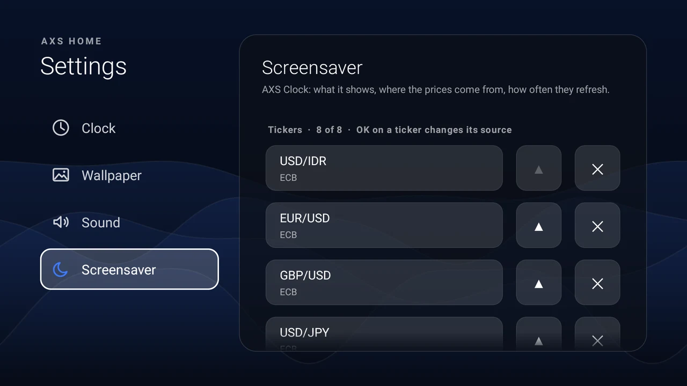
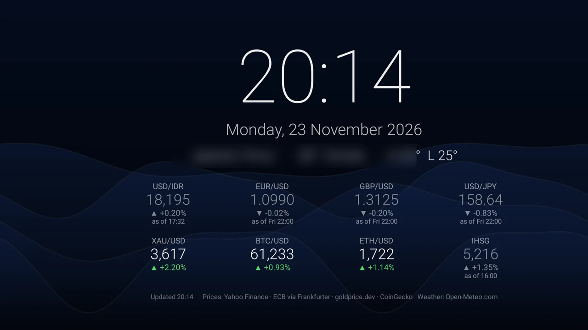

# 33 — Market and weather panel on the AXS Clock screensaver

Builds on [#32](../32-clock-screensaver/README.md). AXS Clock 1.1 shows,
under the time and date, a weather line and eight market tiles, over a
slowly moving, dimmed **Waves** background (the same design as AXS Home):

```
                                  20:35
                         Sunday, 22 November 2026
                 <city>  ·  28°  Cloudy  ·  H 33°  L 26°

      USD/IDR        EUR/USD        GBP/USD        USD/JPY
       18,263         1.0990         1.3125         158.64
      ▲ +0.01%       ▼ -0.02%       ▼ -0.20%       ▼ -0.83%

      XAU/USD        BTC/USD        ETH/USD        SOL/USD
        3,539         60,728          1,705          70.06
                     ▲ +1.59%       ▲ +1.46%       ▲ +0.43%

  Updated 22 Nov 20:35 · FX rates of 20 Nov    Prices: CoinGecko · goldprice.dev · ...
```

The whole block still moves to a new spot once a minute against burn-in.

## Data sources

All free, no account and no API key. Each is credited on screen, as its
terms ask.

| Data | Source | Freshness | Terms |
|---|---|---|---|
| BTC, ETH, SOL (24 h change) | [CoinGecko keyless API](https://docs.coingecko.com/docs/keyless-public-api) | every 2 min | [API terms](https://www.coingecko.com/en/api_terms), attribution required |
| XAU/USD | [goldprice.dev](https://goldprice.dev/docs/api-reference) spot | 15 min delayed, every 5 min | [terms](https://goldprice.dev/terms): free tier needs a visible credit |
| USD/IDR, EUR/USD, GBP/USD, USD/JPY | ECB reference rates via [Frankfurter](https://frankfurter.dev) | once per working day (checked hourly) | ECB public data |
| Weather | [Open-Meteo](https://open-meteo.com) | every 15 min | [free for non-commercial use](https://open-meteo.com/en/terms), CC BY 4.0 |

NASDAQ, S&P 500, Dow Jones, IHSG and crude oil are **not** shown: no free
source found allows this use (Stooq is personal-use only and now keyed,
Twelve Data's free plan has no indices or commodities, and Yahoo Finance's
endpoint is unofficial). Add them here if a clean source appears.

- **Gold change:** goldprice.dev's free tier has no daily history, so the
  change is computed against AXS Clock's own sample from about 24 hours
  earlier. It appears after the screensaver has run on two days.
- **FX change:** against the previous ECB publication. On weekends and
  holidays the rates stay at the last working day; the footer shows which
  ("FX rates of 20 Nov").
- **Stale and offline:** values not refreshed for an hour turn grey; the
  footer says "Offline · last update …" when the TV has no network. The last
  values are cached and shown instantly.

Symbols, order and sources are in
[`apps/clock/config/clock.conf`](../../apps/clock/config/clock.conf)
(`ticker|<label>|<source>|<symbol>[|invert]`), as are `background|waves`
(`orbit`, `pop`, `bloom` or `black`) and `weather|auto` / `weather|off`.

## Screensaver settings on the TV (#48)

☰ → Home settings → **Screensaver** (AXS Clock 1.2) changes all of this
without editing `clock.conf`:



- **Tickers** (up to 8): OK on a ticker switches it to its next available
  source; ▲ moves it up, ✕ removes it; *Add a ticker* opens a catalogue of
  currencies, metals, crypto, indices (IHSG, S&P 500, Dow Jones, NASDAQ,
  Nikkei 225), WTI / Brent oil and US ETFs (SPY, QQQ).
- **Data sources** (opt-in; the defaults stay the keyless ones above):
  - **Yahoo Finance**: live FX, indices, futures, crypto. Its chart endpoint
    is unofficial and may stop working; credited on screen.
  - **Twelve Data** and **Finnhub**: need your own free API key; a
    **CoinGecko demo key** is optional and allows a 1-minute refresh.
  - Keys are typed on the TV (the phone remote keyboard from #46/#47 makes
    it easy), kept only in AXS Clock's private storage, sent to the provider
    in a header (never in a URL), shown only masked (`••••1a2b`) and never
    returned to AXS Home. `revert.sh` deletes them with the app.
  - Turning a source off moves its tickers to another source, or hides
    tickers only it can provide; they come back when it is on again.
  - TradingView is not offered: it has no data API for personal accounts,
    and logging in to its website from the TV to scrape it is against its
    terms and would store your password on the TV.
- **Refresh every** 1, 2, 5 or 15 minutes, held to each provider's free
  plan (CoinGecko 2 min, or 1 with a key; goldprice.dev 5 min; ECB hourly;
  Twelve Data 2 min per symbol for its 800 calls a day).
- **Background**, **Weather** on/off and the **fallback city**, and
  **Preview** (any key returns).
- **Freshness:** prices are fetched as soon as the screensaver starts. A
  value older than two refreshes, or from a closed market, turns grey with
  its time (`as of 16:00`, `as of Fri 22:00`); ECB rates show when they were
  published.



**How Home talks to Clock:** AXS Clock exports a settings provider guarded
by a *signature* permission, so only AXS Home (built with the same key) can
read or change it; other apps and `adb shell content call` are refused.
AXS Home itself still has no INTERNET permission.

## Weather location (private)

- **Automatic:** the TV's approximate location from Android's network
  location. AXS Clock gets `ACCESS_COARSE_LOCATION` (granted by `apply.sh`)
  and rounds the position to about 1 km before asking Open-Meteo. The city
  name comes from Android's own geocoder.
- **Fallback:** if the TV has no location, set `weather_city=<city>` in your
  `.env` and re-run `apply.sh`. It is pushed to the TV as
  `Android/data/io.github.yohannaftali.axsclock/files/local.conf`, never
  printed, never committed (the pre-commit hook blocks `.env` values).
- The city is shown only on the TV screen. Don't commit screenshots of
  the screensaver.

## Network and power

- Fetches only while the screensaver shows; it stops the moment you press
  a button. No boot receiver, no background service, no alarms: start-up and
  shutdown are unaffected.
- Keyless requests carry no identifier (generic `User-Agent`, no key, no
  device id); a keyed provider receives only the key you entered.
- Measured on this TV: about 9.5% of one CPU core while showing (mostly the
  Waves animation; `background|black` for less), about 0.15% after waking
  with the fetch thread gone.
- AXS Home still has no INTERNET permission; only AXS Clock does.

## Use

```sh
sh changes/33-market-panel/apply.sh     # build, install 1.2, grant location, keep as screensaver
sh changes/33-market-panel/check.sh     # 0 = 1.1 with INTERNET and location is the screensaver
sh changes/33-market-panel/revert.sh    # back to the offline clock from #32
```

## Baseline and revert

`baseline.txt` records the offline AXS Clock (versionCode 1, no INTERNET),
the screensaver component and the git commit holding the offline source.
`revert.sh` rebuilds `apps/clock` from that commit (`git archive`),
uninstalls 1.1 (Android refuses a lower versionCode), which also removes its
cache, granted permission and `local.conf`, installs the offline build and
restores the screensaver, then compares each value with the baseline.
`VERIFY_ONLY=1` only compares. To remove AXS Clock completely afterwards, run
[`changes/32-clock-screensaver/revert.sh`](../32-clock-screensaver/README.md).

## Lock-out risk

None. Screensaver only; the clock keeps working without network, and any
button wakes the TV.
