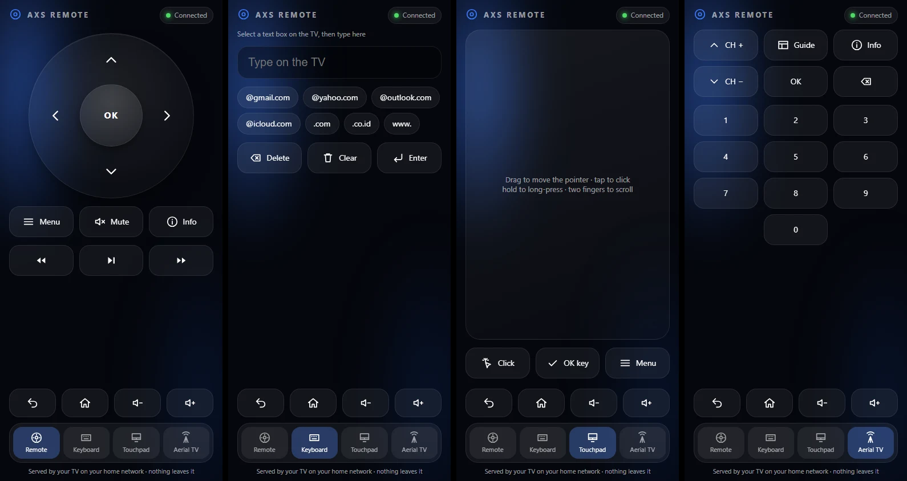
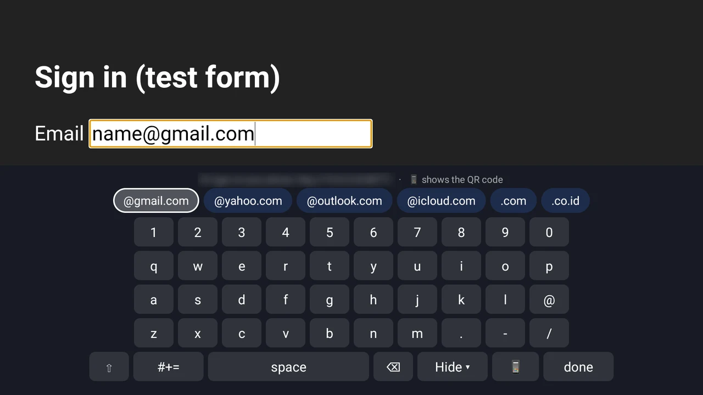

# 40 — Phone remote (AXS Remote)

Open **`http://<TV IP>:8077`** in a phone's browser (iPhone or Android):
it is a remote served by the TV itself — nothing to install on the phone.
☰ → **Phone remote** shows that address and a QR code for it, so you never
have to look the IP up. The address stays the same, so bookmark it or add
it to the phone's home screen (#46).

Four modes, picked from the tab bar at the bottom (#55). Back, Home and
volume −/+ stay above the tabs in every mode; the last mode is remembered,
and `?mode=remote|keyboard|touch|tv` opens one directly (for a bookmark).



- **Remote:** round D-pad with OK, Menu, Mute, Info, rewind / play-pause /
  fast-forward. Holding an arrow or volume repeats it.
- **Keyboard:** when a text box is focused on the TV (YouTube search, TV
  Bro, web forms, Settings), its hint appears and whatever you type is sent
  to the TV; Enter submits. One-tap `@gmail.com`, `@yahoo.com`,
  `@outlook.com`, `@icloud.com`, `.com`, `.co.id`, `www.` (an `@…` replaces a
  domain already typed), Delete (holds to repeat) and Clear. The page
  switches to this mode by itself when a text box gets focus while you are
  in Remote mode. (Phones only open their keyboard after a tap.)
- **Touchpad:** drag to move a pointer on the TV, tap to click, hold to
  long-press, two fingers to scroll; the pointer hides after 4 seconds. Best
  in TV Bro and other apps made for touch.
- **Aerial TV:** CH +/−, Guide, Info, OK, delete and a 0–9 pad for Live TV.
- **Look:** line icons (inline SVG, no emoji, no external files) and a soft
  moving light in the colour of the TV's current AXS Home wallpaper (Waves
  blue, Orbit green, Pop red, Bloom light blue), taken from AXS Home when the
  phone connects.

### Touchpad pointer (accessibility service)

Android 11 lets an app act inside other apps only as an **accessibility
service**, so AXS Remote has one, *AXS Remote touchpad*, which `apply.sh`
turns on (`enabled_accessibility_services`, `accessibility_enabled`;
`revert.sh` restores both from `baseline.txt`). It draws the pointer as an
overlay. Gestures (`dispatchGesture`) would be the natural way to tap, but
Android 11 cancels them on devices without a touchscreen, like this TV, so on
a tap or a two-finger drag the service finds the item under the pointer in
the layout of the app in front and presses or scrolls it with accessibility
actions. **That layout is read only at that moment, on the TV; nothing is
stored, logged or sent.** Apps that draw their own UI without accessibility
information (some games, video players) may not react to the touchpad: use
Remote mode there.
- On the TV, AXS Remote is also a small on-screen keyboard for the physical
  remote (arrows + OK), because Gboard is not the active keyboard while this
  change is applied (#47):
  - **Hide ▾** (or UP from the top row) puts it away, so the D-pad reaches
    the app's other buttons; OK on the field brings it back. BACK and
    *done* still close it too.
  - **Suggestions** above the keys in e-mail fields (`@gmail.com`,
    `@yahoo.com`, `@outlook.com`, `@icloud.com`, `.com`, `.co.id`; an
    `@…` chip replaces a domain already typed) and web-address fields
    (`www.`, `.com`, `.co.id`, `https://`). None in password or plain
    fields; nothing typed is learned or stored.
  - **#+=** switches to symbols; **📱** shows the phone-remote QR code and
    address in place of the keys (OK or BACK returns), to type on the phone
    instead.



## How it works

Android 11 does not let an app send keys to other apps. The active
**keyboard (input method)** can, so AXS Remote (`io.github.yohannaftali.axsremote`,
37 KB, plain Java, no libraries) is installed as the TV's keyboard. Arrow
keys are sent as D-pad events (Android TV's own lists ignore keyboard-style
events), text goes straight into the focused field, volume uses the audio
service, media keys go to the playing app, and HOME starts the home screen
(allowed by the `SYSTEM_ALERT_WINDOW` app-op).

The page is served over **plain HTTP on port 8077** (ports below 1024 need
root) for as long as AXS Remote is the TV's keyboard: Android keeps the
keyboard running, and the server starts with it — no QR screen to open
first, no pairing, no time limit. Until #46 it was HTTPS with a certificate
made on the TV and a token in the QR code; iPhones opened the page but
Safari would not let its WebSocket use that self-signed certificate, so it
never connected.

## Safety

- **Owner's choice (#46): no pairing.** Any device on the same network can
  open the remote while AXS Remote is the keyboard, and typed text crosses
  the home network unencrypted. Don't type passwords from the phone on a
  network you don't trust; `revert.sh` turns it all off.
- A WebSocket opened by some other web page (its `Origin` is not the TV's
  address) is refused, so a site visited on the phone can't drive the TV.
- Only a fixed list of remote commands exists: no shell, no files, no app
  installs. The page has no external resources.
- The TV's IP is read at runtime and appears only on the TV screen and in
  the QR code; it is never written to logs or to this repository. AXS Home
  itself still has no network access — only AXS Remote does.

## Tested on this TV (2026-11-22)

Driven from a PC acting as the phone (same protocol as the page):

| App | Arrows / OK / Back | Typing | Notes |
|---|---|---|---|
| AXS Home | ✅ | – | menu, tiles, inputs |
| YouTube | ✅ | not tested | account picker reacts to arrows |
| TV Bro | ✅ | ✅ address bar and web page fields | Enter loads the page |
| TV Settings | ✅ (after sending D-pad-type events) | ✅ on-screen keyboard with the remote | |
| Live TV | opens | – | no antenna here: CH keys not tested |
| Netflix | opens | – | Netflix blocks screenshots and exposes no UI tree: **please check with your phone** |

Also checked: volume up/down (and restored), HOME from inside apps, page
served.

#55 (2026-11-23): pointer drawn and moved; tap on the TV Bro tile opened TV
Bro; in TV Bro a page button was clicked and two-finger drags scrolled the
page; the hello message reports the pointer; theme follows the wallpaper
(Pop → `#FF5A64`, back to Waves → `#3D7BFF`); four modes rendered at phone
size in Edge; revert restores keyboard and accessibility settings (check 1),
apply twice → check 0. Not checked: a real phone's touch (owner), long-press
in a real app, reboot.

#46 (2026-11-23): page served over HTTP with `ws://`; two clients at once
both connected; a WebSocket with a foreign `Origin` refused (403); keys sent
without any token; the server is back as soon as AXS Remote is the keyboard
again (switching keyboards away and back). Not checked here: a real iPhone
(owner), a reboot.

#47 (2026-11-23), in TV Bro on a local test form: e-mail field shows the
suggestion row; `name@` then `@yahoo.com` then `@gmail.com` gives
`name@gmail.com`; URL field `www.` + `example` + `.com` gives
`www.example.com`; password and plain text fields show no suggestions;
Hide ▾ and UP from the top row close the keyboard and the D-pad then moves
TV Bro's cursor; 📱 shows the QR panel and BACK returns to the keys; #+=
symbols layer; text from the phone lands in the field. Not checked: YouTube
search and TV Settings with the new layout.

## Use

```sh
sh changes/40-phone-remote/apply.sh     # build, install, set as keyboard, add the ☰ item
sh changes/40-phone-remote/check.sh     # 0 = installed, the keyboard, and port 8077 answers
sh changes/40-phone-remote/revert.sh    # Gboard back, AXS Remote removed (☰ item disappears)
```

## Baseline and revert

`baseline.txt` records `default_input_method` and `enabled_input_methods`
(Gboard only), that AXS Remote was not installed, and (since #55)
`enabled_accessibility_services` (unset) and `accessibility_enabled` (0). `revert.sh` sets Gboard
back, uninstalls AXS Remote, restores
both settings and compares them with the baseline (exit 1 on a difference,
2 on a failed TV step). `VERIFY_ONLY=1` only compares.

## Lock-out risk

Low. If AXS Remote misbehaved, typing on the TV could be affected; the
physical remote still navigates, Settings → Device Preferences → Keyboard
can switch back to Gboard, and `revert.sh` (or
`sh scripts/tv.sh shell ime set com.google.android.inputmethod.latin/com.android.inputmethod.latin.LatinIME`)
restores it. The touchpad service only draws a non-touchable pointer and
acts on request; to turn it off without reverting:
`sh scripts/tv.sh shell settings delete secure enabled_accessibility_services`
(or Settings → Device Preferences → Accessibility). ADB, the home screen
and the network are not touched.
